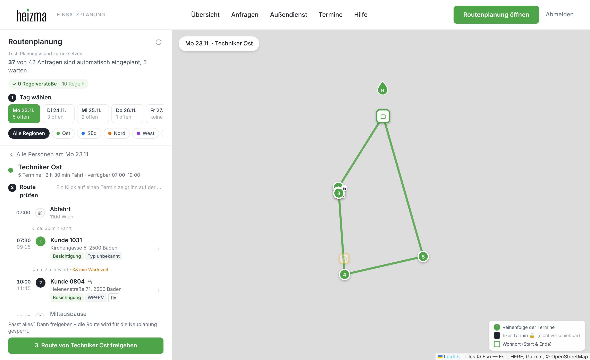
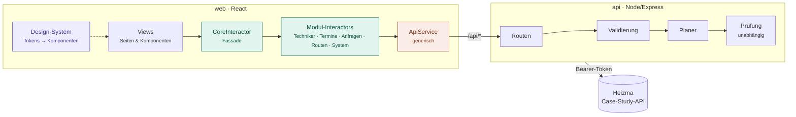

<div align="center">

# Heizma · Einsatz- & Routenplanung

**Offene Besichtigungs-Anfragen automatisch auf Außendienst und Tage verteilen – mit fahrzeitoptimierter Tagesroute pro Person.**
Der Planer schaut drauf und gibt frei, statt selbst zu rechnen.

`TypeScript` · `React 18` · `Node/Express` · `Tailwind` · `Google Maps / Leaflet` · `Vitest` · `Docker`



</div>

---

## Die Case-Anforderungen – und wo sie gelöst sind

| Anforderung aus der Case Study | Lösung | Mehr |
|---|---|---|
| Anfragen **automatisch** auf Außendienstler und Tage verteilen | Planer in 3 Phasen: Greedy *Cheapest Insertion* → 2-opt + Relocate → Warteliste erneut | [Planung & Regeln](docs/03-planung-und-regeln.md) |
| **Fahrzeitoptimierte** Tagesroute pro Person | Echte Fahrzeitmatrix aus `/travel/path` (13 Fahrten pro Call). Die Optimierung ist nie schlechter als Greedy (getestet), die Ersparnis zeigt der Planer an | [Fahrzeiten](docs/03-planung-und-regeln.md#fahrzeiten) |
| Planer soll **nur draufschauen und freigeben** | 3-Schritt-UI: Tag wählen → Route prüfen → freigeben. Freigegebene Routen bleiben bei jeder Neuplanung fix, Export als `.ics` | [Ergebnis](docs/01-aufgabe-und-ergebnis.md) |
| **Alle 8 Regeln** eingehalten | Jede Regel im Planer umgesetzt **und** unabhängig nachgeprüft: Badge „✓ 0 Regelverstöße · 10 Regeln“ | [Regeln & Nachweis](docs/03-planung-und-regeln.md#die-regeln--umsetzung-und-nachweis) |
| **Unsaubere Daten** (fehlende Koordinaten, Tippfehler, ohne Gebiet, ohne Verfügbarkeit …) | Validierung mit Fehler / Warnung / Hinweis, Korrektur direkt in der App, Geocoding, Eskalation | [Datenqualität](docs/04-datenqualitaet.md) |
| **Ältere Anfragen zuerst**, wenn die Kapazität nicht reicht | Einplanung strikt nach Eingang, Warteliste mit Platz X von Y, „Kunde informieren“ | [Priorität](docs/03-planung-und-regeln.md#die-regeln--umsetzung-und-nachweis) |
| „Lieber wenige Kernfunktionen sauber als alles halb“ | Saubere Schichten, Design-System, 65 automatisierte Tests, Architektur-Wächter in CI | [Architektur](docs/02-architektur.md) · [Tests](docs/06-tests-und-qualitaet.md) |

---

## Architektur in 30 Sekunden



- **Backend:** Plant serverseitig und rechnet jeden Plan mit **eigenem, unabhängigem Code** nach (Vier-Augen-Prinzip). Der Heizma-Token verlässt nie den Server.
- **Frontend:** Clean Architecture im MVVM-Stil (verwandt mit **VIPER**): Views sprechen nur mit dem `CoreInteractor`, jedes Modul kennt nur seine Daten, nur der `ApiService` ruft `fetch` auf. Abhängigkeiten zeigen nach unten, Daten fließen nach oben.
- **Design-System:** Farben, Radien und Ebenen als Tokens in **einer** CSS-Datei. Tailwind und die Karten lesen dieselben Variablen.
- **Regeln werden erzwungen**, nicht nur dokumentiert: `npm run check:architecture` schlägt fehl, sobald eine View `fetch` aufruft oder eine Hex-Farbe fest codiert.

→ [Ausführlich: Architektur](docs/02-architektur.md)

---

## Schnellstart

```bash
cp .env.example .env        # HEIZMA_API_TOKEN eintragen – oder DATA_SOURCE=mock für offline
docker compose up --build   # → http://localhost:8080
```

Login: `planner@heizma.at` / `1nvite0nly` · Lokale Entwicklung, alle Befehle und Umgebungsvariablen: [Setup](docs/09-setup.md)

| Befehl | Zweck |
|---|---|
| `npm run dev` | API + Web mit Hot Reload |
| `npm run check` | Typecheck + Architektur-Wächter + alle Tests |
| `npm run test:coverage` | Tests mit Coverage-Report (API + Web) |

---

## Dokumentation

| | Seite | Inhalt |
|---|---|---|
| 1 | [Aufgabe & Ergebnis](docs/01-aufgabe-und-ergebnis.md) | Problemverständnis, Ablauf für den Planer, Screenshots |
| 2 | [Architektur](docs/02-architektur.md) | Systemüberblick, Frontend-Schichten (Interactor/VIPER), Datenfluss, Ordnerstruktur |
| 3 | [Planung & Regeln](docs/03-planung-und-regeln.md) | Algorithmus, Fahrzeiten, jede Regel mit Umsetzung und Nachweis |
| 4 | [Datenqualität](docs/04-datenqualitaet.md) | Umgang mit unsauberen Daten, Korrekturen, Eskalation, KI-Hinweise |
| 5 | [Design-System](docs/05-design-system.md) | Tokens, Komponenten-Katalog, Styling-Regeln, Styleguide `/styleguide` |
| 6 | [Tests & Qualität](docs/06-tests-und-qualitaet.md) | Teststrategie, Coverage, Architektur-Wächter, visueller Vergleich |
| 7 | [API-Referenz](docs/07-api.md) | Alle Endpunkte der eigenen API |
| 8 | [Trade-offs & Ausblick](docs/08-trade-offs-und-ausblick.md) | Bewusste Vereinfachungen, Grenzen, was mit mehr Zeit käme |
| 9 | [Setup](docs/09-setup.md) | Installation, Docker, Konfiguration, Mock-Modus |
