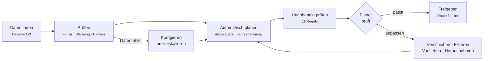
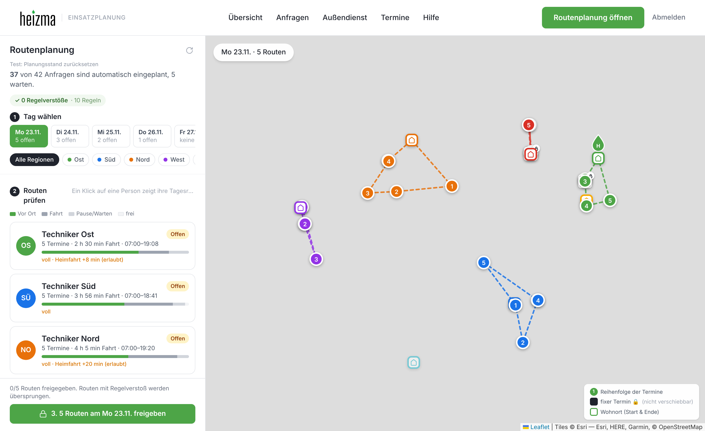
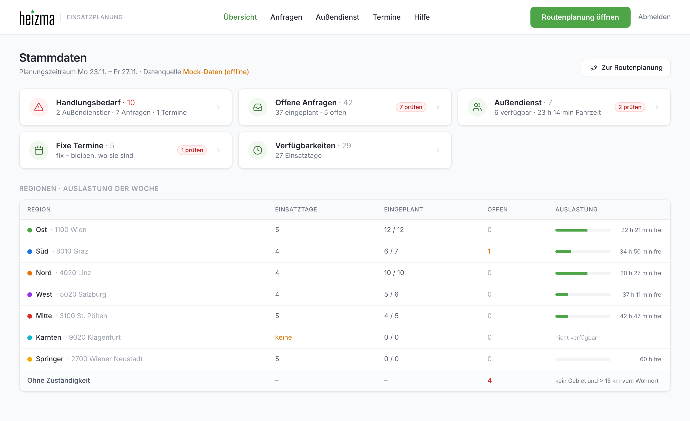
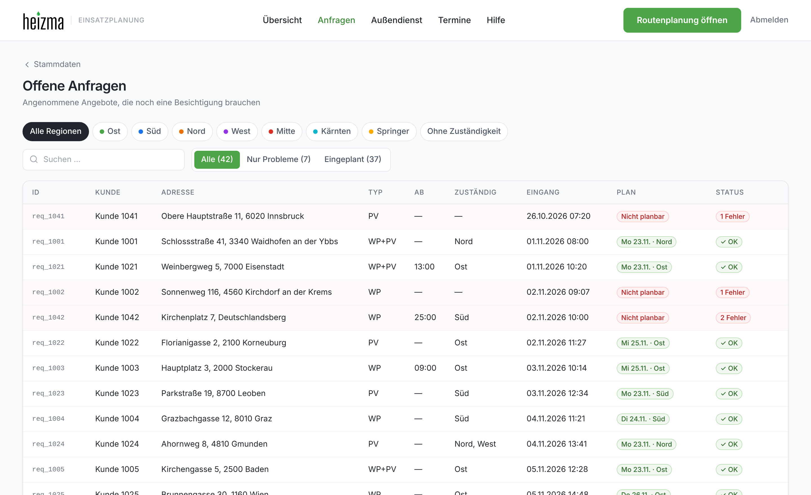
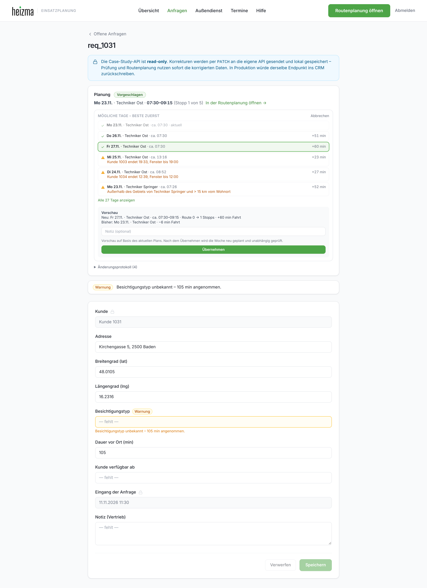
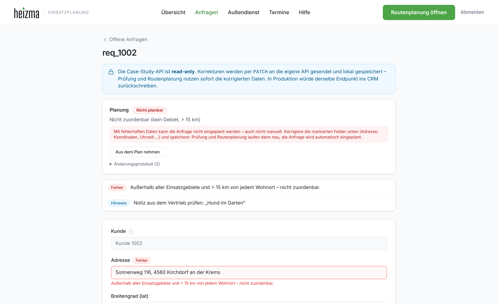
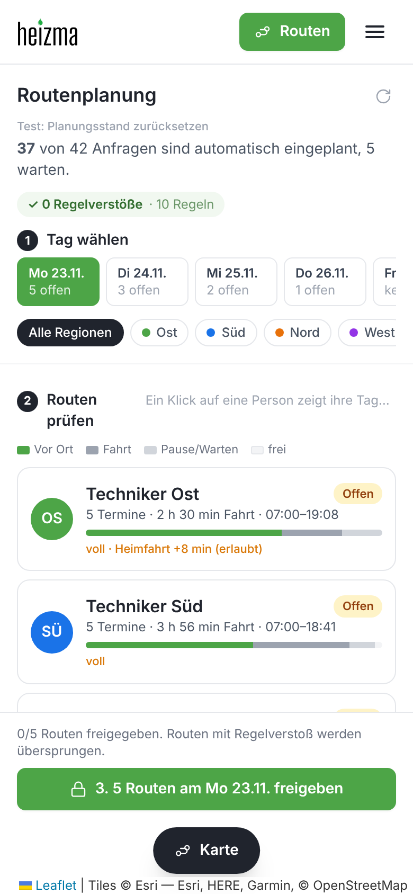
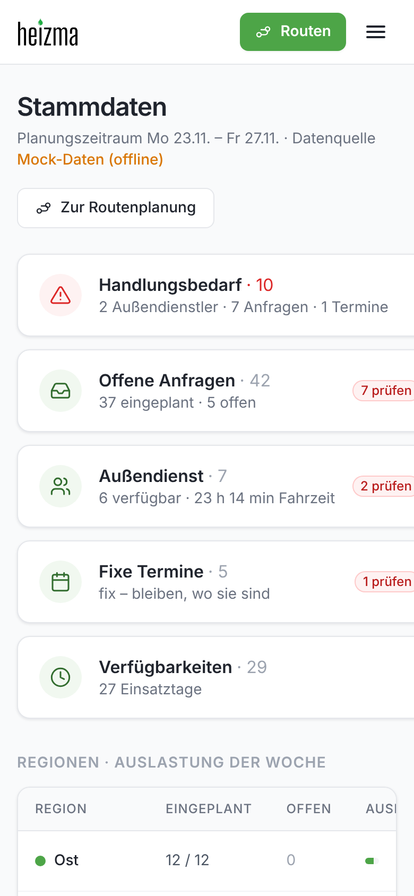

[← Übersicht](../README.md) · **1 Aufgabe & Ergebnis** · [2 Architektur →](02-architektur.md)

# Aufgabe & Ergebnis

## Wie ich das Problem verstanden habe

Nach jedem angenommenen Angebot fährt jemand aus dem Außendienst zur Besichtigung. Heute verteilt eine Person rund 150 offene Anfragen pro Woche von Hand auf sieben Außendienstler – das kostet täglich Stunden, ist fehleranfällig und selten die beste Route.

Das eigentliche Ziel ist also nicht „ein Algorithmus“, sondern **Vertrauen**: Der Planer soll einen Vorschlag bekommen, den er in Minuten prüfen und freigeben kann. Daraus ergeben sich drei Leitfragen:

1. **Stimmt der Plan?** → Jede Regel wird eingehalten und *unabhängig nachgewiesen*, nicht nur behauptet.
2. **Verstehe ich den Plan?** → Jede Route ist als Zeitplan lesbar: Abfahrt, Anfahrt, Wartezeit, Pause, Heimfahrt.
3. **Was mache ich mit dem Rest?** → Was nicht passt, hat einen Grund und genau eine nächste Aktion (korrigieren, Kunde informieren, eskalieren).

> **Grundsatz:** Das System schlägt vor, der Planer entscheidet. Regelbrüche sind möglich, aber nie unsichtbar – nur mit Begründung und als gelbe „bewusste Ausnahme“ markiert.

## Der Ablauf für den Planer

| Schritt | Was der Planer sieht |
|---|---|
| **1 Tag wählen** | Tages-Tabs mit „3 zur Freigabe“ / „✓ freigegeben“ (gezählt werden Routen), Regionsfilter je Außendienstler |
| **2 Routen prüfen** | Je Person: Auslastungsbalken (vor Ort · Fahrt · Pause · frei), Klick zeigt Zeitplan und Route auf der Karte |
| **3 Freigeben** | Pro Route oder alle Routen des Tages. Routen mit Regelverstoß sind gesperrt. |

## Screens

### Routenplanung – Tagesübersicht
Plan-Prüfung oben („✓ 0 Regelverstöße · 11 Regeln“) und die Bilanz „Diese Woche 88 von 150 · 37 vorgeplant · 25 nicht planbar“, darunter alle Personen des Tages mit Auslastung.

### Stammdaten – Startseite
Handlungsbedarf zuerst, dann die Bereiche und die Wochenauslastung je Region.

### Anfragen mit Plan-Status
Jede Zeile zeigt, wo die Anfrage im Plan steht (Tag · Person, Warteliste, Nicht planbar) und ob ihre Daten in Ordnung sind.

### Eingreifen: Verschieben mit Vorschau
Keine leeren Dropdowns: alle möglichen Tage, regelkonforme zuerst, mit voraussichtlicher Uhrzeit und Zusatz-Fahrzeit. Regelbrüche brauchen eine Begründung.

### Datenfehler direkt beheben
Fehlerhafte Felder sind markiert und erklärt. Nach dem Speichern laufen Prüfung und Planung sofort neu.

### Mobil
Liste und Karte im Wechsel – für den Blick unterwegs.

  
  &nbsp;
  

> Screenshots mit den Mock-Daten aus `api/src/fixtures` (gleiches Schema, gleiche Datenprobleme in klein). Kartenkacheln fehlen in der Aufnahmeumgebung ohne Internet.

## Was bewusst angenommen wurde

- **Freigabe = Benachrichtigung.** In Produktion würden mit „Route freigeben“ Kunden (Terminbestätigung) und Außendienst (Kalender) informiert. Im Prototyp wird nur die Freigabe gespeichert.
- **Anfrage wird Termin.** Freigegebene Anfragen erscheinen unter „Termine“ (simuliert). „Freigabe zurücknehmen“ macht sie wieder zu Anfragen.
- **Kein Rückgängig nach Veröffentlichung.** Wäre in Produktion eine Absage an Kunden – das läuft über den normalen Umplanungsprozess.

---

[← Übersicht](../README.md) · [2 Architektur →](02-architektur.md)
