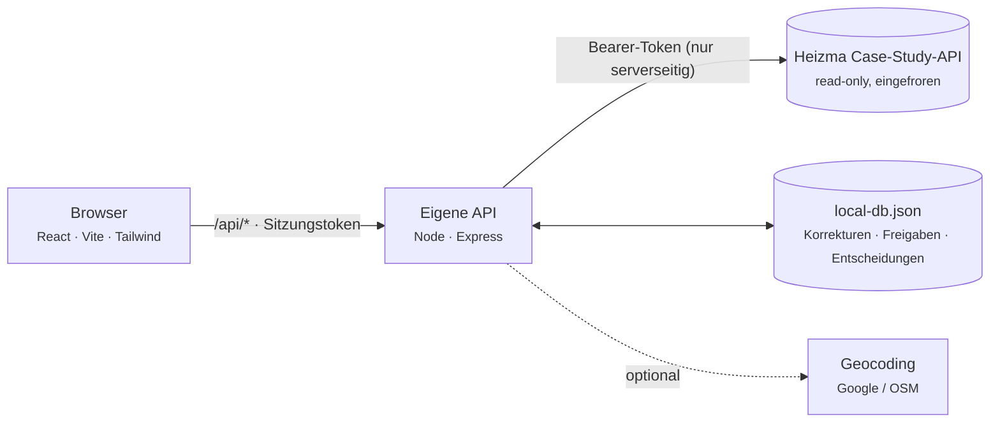
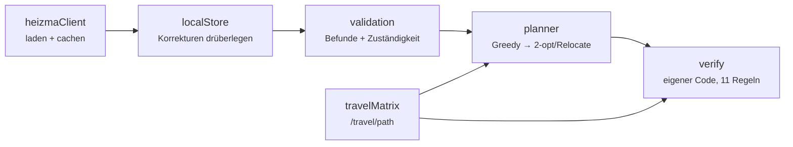
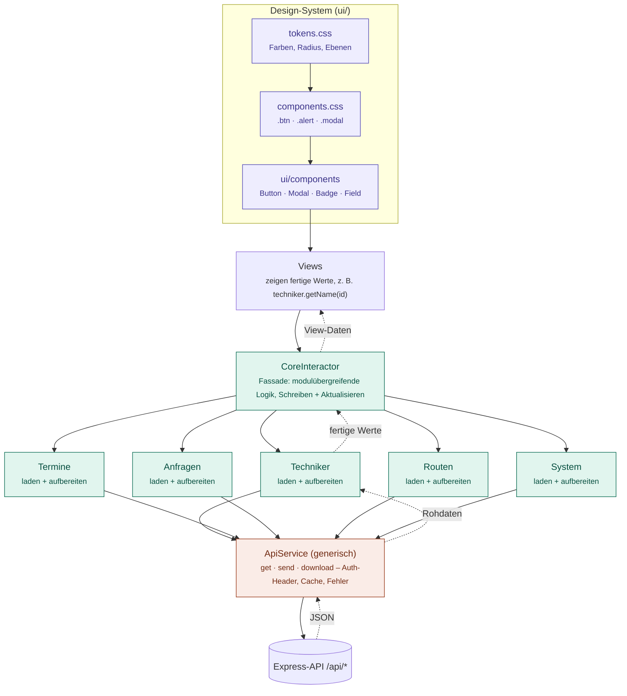
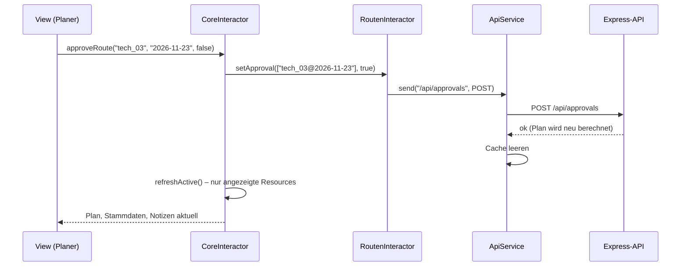

[← 1 Aufgabe & Ergebnis](01-aufgabe-und-ergebnis.md) · **2 Architektur** · [3 Planung & Regeln →](03-planung-und-regeln.md)

# Architektur

## Systemüberblick



| Entscheidung | Warum |
|---|---|
| **Planung im Backend** | Ein Plan, eine Wahrheit – Web und Prüfung sehen dasselbe Ergebnis. Der Token bleibt auf dem Server. |
| **Eigene API vor der Heizma-API** | Cache (Datenstand ist eingefroren), Fahrzeitmatrix, Validierung und lokale Korrekturen an einer Stelle. In Produktion würde nur der Speicher (CRM statt JSON) getauscht. |
| **Ein Typ-Modell** | `api/src/types.ts` wird vom Frontend direkt importiert – keine doppelten Definitionen. |
| **TypeScript durchgehend** | Passt zum Stack aus der Stellenausschreibung; Fehler fallen beim Bauen auf, nicht beim Planer. |

## Backend: Pipeline mit unabhängiger Prüfung



`verify.ts` importiert **nichts** aus `planner.ts`. Es rechnet nur aus den ausgegebenen Uhrzeiten, den Originaldaten und derselben Fahrzeitquelle nach. Findet der Planer einen Fehler nicht, findet ihn die Prüfung – Tests schleusen gezielt Fehler ein und erwarten, dass sie erkannt werden.

## Frontend: Interactor-Architektur

Aus meinem Swift-Hintergrund (MVVM) übernommen: klare Schichten mit genau einer Richtung der Abhängigkeit. Die Begriffe entsprechen **Clean Architecture** (Robert C. Martin) bzw. **VIPER** auf iOS.



*Durchgezogen = Aufruf/Abhängigkeit (zeigt nach unten), gestrichelt = Datenfluss (nach oben). Rückweg exemplarisch für „Techniker“.*

### Die Schichten

| Schicht | Datei(en) | Aufgabe | Darf nicht |
|---|---|---|---|
| **ApiService** | `core/ApiService.ts` | Einziger `fetch`-Aufruf. Auth-Header, GET-Cache, gebündelte parallele Requests, Cache leeren nach Schreiben, einheitliche `ApiError`, Abmelden bei 401 | Module oder Pfade kennen |
| **Resource** | `core/Resource.ts` | Beobachtbarer Ladezustand (`data`, `error`, `loading`) – wie ein `ObservableObject`. Nur die jüngste Anfrage gewinnt | – |
| **Modul-Interactor** | `modules/*/…Interactor.ts` | Lädt **nur seine** Daten und bereitet sie auf: `getName`, `getAvailability`, `dayStatus`, `requestStatuses` … | Andere Module kennen |
| **CoreInteractor** | `core/CoreInteractor.ts` | Fassade für Views. Jede schreibende Aktion: ausführen → **alle gerade sichtbaren Daten neu laden**. Modulübergreifende Logik (z. B. Plan-Status + Personennamen) | Selbst `fetch` aufrufen |
| **Views** | `pages/`, `components/` | Rendern und UI-Zustand (Auswahl, Dialog offen …) | Formatieren, `fetch`, Hex-Farben |

### Ein Beispiel von oben bis unten

```tsx
// View
const { techniker } = useCore();
useResource(techniker.data);                       // abonnieren + laden
<p>{techniker.getLabel(route.technicianId)}</p>    // „Techniker Nord · 4020 Linz“
<p>{techniker.getAvailability(id, day)}</p>        // „07:00–19:00“ / „gesperrt“
```

```ts
// modules/techniker/TechnikerInteractor.ts
getAvailability(id: string, day: string): string {
  const entry = this.data.getState().data?.availability.find((a) => a.technicianId === id && a.date === day);
  if (!entry) return 'nicht verfügbar';
  return entry.blocked ? 'gesperrt' : `${entry.start}–${entry.end}`;
}
```

### Schreiben: ein Ablauf für alle Aktionen



Früher musste jede View nach einer Änderung selbst `plan.reload(); stamm.reload(); notes.reload()` aufrufen und sich per `window`-Event gegenseitig benachrichtigen. Jetzt passiert das an **einer** Stelle – und alle Views, die dieselben Daten zeigen, sind gleichzeitig aktuell.

### Begriffe zum Nachschlagen

| Hier | Fachbegriff |
|---|---|
| `CoreInteractor` | **Facade Pattern**; in Clean Architecture der *Interactor / Use Case* |
| Modul-Interactor | **Repository** + **Presenter / View-Model-Mapper** (VIPER: Presenter formatiert) |
| `ApiService` | **API Client / Gateway** |
| `Resource` + `useResource` | **Observer Pattern**, React *External Store* (`useSyncExternalStore`) |
| Ordner je Fachbereich | **Feature-based / Vertical-Slice** Struktur |
| Tokens → Komponenten | **Design Tokens**, **Design System** |

Kurz: *Geschichtete Clean Architecture im MVVM-Stil – eine Fassade über Modul-Interactors mit Repository-/Gateway-Trennung, dazu ein Token-basiertes Design-System.*

### Bewusster Kompromiss

Die eigene API liefert Techniker, Anfragen und Termine in **einem** Endpunkt (`/api/stammdaten`). Jedes Modul lädt ihn und behält nur seinen Ausschnitt; der `ApiService` bündelt die Aufrufe zu **einem** Request. Die generischen Stammdaten-Seiten (Liste/Detail für alle Bereiche) nutzen den Gesamtbestand über `system.stammdaten`. Mit mehr Zeit: ein Endpunkt pro Modul ([Ausblick](08-trade-offs-und-ausblick.md)).

### Regeln, die automatisch geprüft werden

`npm run check:architecture` ([scripts/check-architecture.mjs](../scripts/check-architecture.mjs)) läuft in CI und schlägt fehl, wenn:

- außerhalb des `ApiService` `fetch` aufgerufen wird (Ausnahme: Login vor der Sitzung),
- eine View den `ApiService` direkt anspricht,
- alte Datenzugriffe (`useApi`, `apiGet`, `apiSend`) auftauchen,
- Hex-Farben oder Nicht-Token-Farben (`red-`, `amber-` …) außerhalb von `ui/` stehen,
- Alt-Klassen oder selbstgebaute Dialog-Overlays verwendet werden.

## Ordnerstruktur

```
.
├── api/src/
│   ├── index.ts            Routen
│   ├── heizmaClient.ts     Heizma-API (Cache, Mock-Modus)
│   ├── localStore.ts       Korrekturen, Freigaben, Entscheidungen (JSON)
│   ├── validation.ts       Datenprüfung + Zuständigkeit
│   ├── planner.ts          Greedy → 2-opt/Relocate
│   ├── verify.ts           unabhängige Plan-Prüfung
│   ├── travelMatrix.ts     Fahrzeitmatrix aus /travel/path
│   ├── geocode.ts          Adresse ↔ Koordinaten
│   └── types.ts            gemeinsame Typen (auch vom Web genutzt)
├── web/src/
│   ├── core/               ApiService · Resource · CoreInteractor · Provider · Auth
│   ├── modules/
│   │   ├── techniker/      TechnikerInteractor + Typen
│   │   ├── termine/        TermineInteractor
│   │   ├── anfragen/       AnfragenInteractor + Typen
│   │   ├── routen/         RoutenInteractor + Typen
│   │   └── system/         SystemInteractor + Typen
│   ├── ui/                 Design-System: styles/ (Tokens, Komponenten-CSS), components/, theme.ts
│   ├── pages/              Stammdaten · Liste · Detail · Planer · Hilfe
│   ├── components/         Fach-Komponenten (planner/, stammdaten/, …)
│   ├── lib/                reine Helfer (Formatierung, Bereichs-Definitionen)
│   └── __tests__/          Unit-Tests (Vitest)
├── scripts/                Architektur-Wächter
└── docs/                   diese Dokumentation
```

---

[← 1 Aufgabe & Ergebnis](01-aufgabe-und-ergebnis.md) · [3 Planung & Regeln →](03-planung-und-regeln.md)
