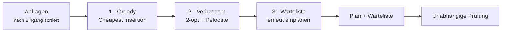
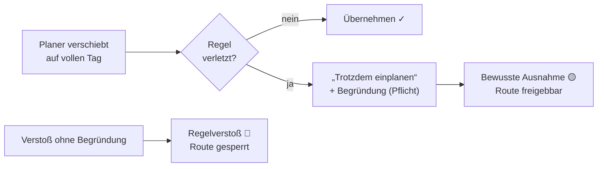

[← 2 Architektur](02-architektur.md) · **3 Planung & Regeln** · [4 Datenqualität →](04-datenqualitaet.md)

# Planung & Regeln

## Der Algorithmus in drei Phasen

1. **Greedy „Cheapest Insertion“** – Anfragen nach Alter sortiert. Für jede werden *alle* zuständigen Personen-Tage und *alle* Einfügepositionen simuliert. Gewählt wird die regelkonforme Position mit dem geringsten Fahrzeit-Zuwachs.
2. **Lokale Verbesserung** – **2-opt** (Abschnitt einer Route umdrehen) und **Relocate** (Anfrage in eine andere Route oder an einen anderen Tag), solange die Gesamtfahrzeit sinkt. Jeder Schritt wird als ganzer Tag neu simuliert – die Regeln bleiben erfüllt.
3. **Frei gewordene Kapazität** – die Warteliste wird in Altersreihenfolge erneut eingeplant.

**Warum eine Heuristik statt eines Solvers?** Für ~150 Anfragen × 7 Personen × 5 Tage ist das in unter einer Sekunde fertig, jeder Schritt ist nachvollziehbar, und jede Regel steckt in genau einer Tages-Simulation. Ein VRPTW-Solver (z. B. OR-Tools) wäre der nächste Schritt für größere Mengen – siehe [Ausblick](08-trade-offs-und-ausblick.md).

**Mittagspause:** wird in jede passende Lücke gelegt – vor der Weiterfahrt, in eine Wartezeit, vor Abfahrt oder nach Heimkehr. Passt sie nicht, entfällt sie (laut Regel) – aber nur, wenn schon die fixen Termine des Tages sie verhindern. **Für einen zusätzlichen Besuch wird sie nie geopfert.**

**Vorgaben des Planers** gehen als harte Randbedingungen ein: freigegebene Routen (unverändert), fixierte Anfragen (Tag + Person) und herausgenommene Anfragen.

## Die Regeln – Umsetzung und Nachweis

Jede Regel ist im Planer umgesetzt **und** wird von `verify.ts` mit eigenem Code nachgerechnet. In der App: Badge „✓ 0 Regelverstöße · 11 Regeln“, aufklappbar mit Anzahl der Einzelprüfungen je Regel.

| # | Regel aus der Case Study | Umsetzung im Planer | Prüfung (`verify.ts`) | Test |
|---|---|---|---|---|
| 1 | Arbeitstag im Verfügbarkeitsfenster, Start/Ende am Wohnort | Tages-Simulation startet und endet am Wohnort | `window` | ✓ |
| 2 | Termin inkl. Anfahrt im Fenster, nur Heimfahrt bis +60 min | Abbruch, wenn Anfahrt oder Termin über das Fenster ragt | `window`, `returnHome` | ✓ |
| 3 | Mittagspause 60 min, Beginn 11:30–13:00, nur ganze Tage | Pause in passende Lücke; entfällt nur, wenn fixe Termine sie verhindern – nie für einen weiteren Besuch | `lunch` (inkl. „hätte gepasst“) | ✓ |
| 4 | `customerAvailableFrom` ist harte Grenze | Früher da → Wartezeit, nie früherer Beginn | `customerFrom` | ✓ |
| 5 | Zuständigkeit: Gebiet → sonst ≤ 15 km → sonst nicht zuordenbar | Punkt-in-Polygon, Haversine-Distanz zum Wohnort | `responsibility` | ✓ |
| 6 | Bestehende Termine bleiben, wo sie sind | Fixe Termine als unverrückbare Stopps | `fixed` | ✓ |
| 7 | Nichts überlappt, auch nicht Fahrzeiten | Lückenlose Zeitkette pro Tag | `travel` | ✓ |
| 8 | Ältere Anfragen zuerst, wenn Kapazität nicht reicht | Einplanung nach `createdAt`; nach der Optimierung Tausch-Durchgang: wartende ältere ersetzt eine jüngere, wo sie regelkonform passt | `priority` – prüft für jede wartende Anfrage jeden möglichen Tausch | ✓ |
| + | Dauer passt zum Typ (unbekannt = 105 min) | Dauer aus Typ, Fallback 105 | `duration` | ✓ |
| + | Jede Anfrage genau einmal: eingeplant oder Warteliste | – | `unique` | ✓ |
| + | Zahlen stimmen: Fahrt + vor Ort + Pause + Warten = Arbeitstag, Wochensummen = Summe der Routen | Jede Lücke vor einem Stopp wird als Fahrt + Pause + Wartezeit ausgewiesen | `totals` | ✓ |

**Eine Bilanz für alle Zähler:** Jede Anfrage steht in genau einem Topf – *diese Woche*, *Warteliste*, *nicht planbar*, *aus dem Plan*. Übersicht, Planer-Kopf, Gebietstabelle und Anfragen-Liste lesen alle aus derselben Funktion (`core.balance()`), darum ergeben die Teile überall dieselbe Gesamtzahl.

**Die Prüfung prüft sich selbst:** Ein Test schleust gezielt Fehler in einen gültigen Plan ein – Überlappung, doppelte Anfrage, verlorene Anfrage, falsche Pause – und erwartet, dass `verifyPlan()` jeden davon meldet.

### Regelbruch: erlaubt, aber nie unsichtbar

## Eingriffe des Planers

Auf jeder Anfrage-Seite und im Stopp-Dialog des Planers gibt es dieselbe Karte „Planung“ – gleiche Endpunkte, gleiche Logik:

| Aktion | Wirkung |
|---|---|
| **Planung ändern …** | Ein Button je Anfrage. Öffnet einen Dialog mit genau den Schritten, die im aktuellen Status möglich sind – jeder mit einem Satz, was danach passiert. |
| **Verschieben / Manuell einplanen** | Sortierte Liste aller möglichen Tage: regelkonforme zuerst, mit Uhrzeit und Zusatz-Fahrzeit. Vorschau vor dem Übernehmen. |
| **Fixieren** | Bleibt bei jeder Neuplanung an diesem Tag und bei dieser Person. |
| **Aus dem Plan nehmen** | Mit Grund, z. B. „Kunde ruft zurück“; jederzeit wieder aufnehmbar. |
| **Kunde informieren / Intern eskalieren** | Für Fälle ohne Lösung – Wartende bzw. fachlich nicht Planbare: Entwurf wird gespeichert (nicht versendet). |
| **Neu planen** | Lädt die Heizma-Daten frisch und optimiert neu; optional alle Eingriffe und Freigaben verwerfen. |
| **Änderungsprotokoll** | Was, wann, warum – je Anfrage. |

Die Rückmeldung nach einer Aktion kommt aus dem **tatsächlichen Ergebnis der Neuplanung**, nicht aus der Vorschau.

## Fahrzeiten

`api/src/travelMatrix.ts` baut eine Fahrzeitmatrix aus `POST /travel/path`:

- **Nur nötige Paare:** Punkte, die in einer Route benachbart sein können – also mindestens eine zuständige Person teilen (Wohnort, Anfragen, fixe Termine).
- **13 Fahrten pro Call:** Paare werden zu Pfaden mit bis zu 14 Punkten verkettet.
- **Parallel und gecacht:** 4 Calls gleichzeitig, Ergebnis auf Platte (`api/data/travel-cache.json`).
- **Ohne Vorbereitung startklar:** Alle Fahrzeiten liegen als Seed im Code (`api/src/fixtures/travel-cache.seed.json`) – lokal, in Docker und auf Vercel sofort da. Beim Serverstart werden Daten, Fahrzeiten und Plan im Hintergrund vorberechnet. Neu geladene Fahrzeiten schreibt die lokale API in den Seed zurück; sie kommen mit dem nächsten Push auf Vercel.
- **Fallback:** Fehlt ein Paar, Luftlinien-Schätzung – in der UI mit „≈“ markiert, in der Prüfung ausgewiesen.

**Warum die Heizma-API statt OSRM/Google?** Gleiche Quelle wie bei Heizma selbst, kein zusätzlicher Schlüssel, und das Ergebnis ist deckungsgleich mit dem, was der Planer in der Praxis sieht. Die Abstraktion (`TravelLookup`) erlaubt einen Wechsel ohne Änderung am Planer.

---

[← 2 Architektur](02-architektur.md) · [4 Datenqualität →](04-datenqualitaet.md)
