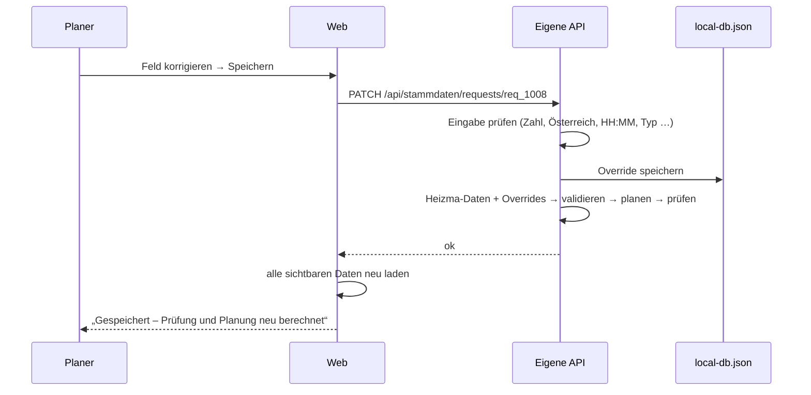

[← 3 Planung & Regeln](03-planung-und-regeln.md) · **4 Datenqualität** · [5 Design-System →](05-design-system.md)

# Datenqualität

> „Die Daten sind absichtlich nicht ganz sauber … So ist es im echten Leben auch.“ – aus der Case Study

Der Ansatz: **nichts still reparieren, nichts still verwerfen.** Jedes Problem wird erkannt, eingestuft, erklärt – und hat eine konkrete nächste Aktion.

## Drei Stufen

| Stufe | Bedeutung | Beispiel |
|---|---|---|
| 🔴 **Fehler** | Blockiert die Planung – auch manuell | Keine Koordinaten, nicht zuordenbar |
| 🟡 **Warnung** | Wird mit dokumentierter Annahme geplant | Typ unbekannt → 105 min |
| 🔵 **Hinweis** | Zur Durchsicht | Freitext-Notiz |

## Was erkannt wird – und was passiert

Umgesetzt in `api/src/validation.ts`.

| Problem im Datenstand | Stufe | Was passiert | Aktion in der App |
|---|---|---|---|
| Anfrage ohne Koordinaten | 🔴 | Nicht planbar | **Koordinaten finden** (Geocoding) → prüfen → speichern |
| Adresse ohne PLZ / Tippfehler | 🟡 | Markiert | Adresse korrigieren, ggf. an Vertrieb eskalieren |
| Besichtigungstyp `null` | 🟡 | 105 min angenommen | – |
| Dauer passt nicht zum Typ | 🟡 | Markiert | Dauer korrigieren |
| Ungültige Uhrzeit bei `customerAvailableFrom` | 🔴 | Nicht planbar | Uhrzeit korrigieren |
| Außerhalb aller Gebiete und > 15 km (z. B. Innsbruck) | 🔴 | *Nicht zuordenbar* | **Intern eskalieren** |
| Außendienstler ohne Gebiet | 🟡 | Nur 15-km-Regel | **Gebiet bestätigen lassen** (Nachricht an Person/Vertrieb) |
| Außendienstler ohne Verfügbarkeit | 🔴 | Wird nicht eingeplant | **Verfügbarkeit anfragen** |
| Fixer Termin an gesperrtem Tag / Überschneidung | 🔴 | Muss umgeplant werden | Gemeldet (Termine sind laut Case nicht verschiebbar) |
| Freitext-Notizen | 🔵 | KI-Hinweise | Zeit-Hinweis mit einem Klick als harte Regel übernehmen |

**Datenfehler sperren die Planung – auch manuell.** Eine Anfrage mit Fehler wird nie eingeplant, auch nicht als Ausnahme. Nach der Korrektur laufen Prüfung und Plan sofort neu, und die Anfrage wird automatisch eingeplant.

## Korrigieren, obwohl die API read-only ist

Die Originaldaten bleiben unverändert; „Original wiederherstellen“ entfernt den Override. In Produktion würde derselbe Endpunkt ins CRM zurückschreiben – Frontend und Planung blieben gleich.

| Bereich | Bearbeitbare Felder |
|---|---|
| Anfragen | `address`, `lat`, `lng`, `visitationType`, `durationMinutes`, `customerAvailableFrom`, `notes` |
| Außendienst | `name`, `region` (Eckpunkte des Gebiets) |
| Fixe Termine | – (laut Case nicht verschiebbar; Konflikte werden gemeldet) |

**Beispiel-Korrekturen:** `api/data/local-db.example.json` trägt für die 8 Anfragen ohne Koordinaten die Ortsmitte der PLZ nach. Aktivieren mit `cp api/data/local-db.example.json api/data/local-db.json`. `req_1122` (Innsbruck) bleibt bewusst *nicht zuordenbar* – Datenfehler behoben ✓, echte Geschäftsregel bleibt bestehen ✓.

## Nicht eingeplant: je Grund genau eine Aktion

| Grund | Aktion |
|---|---|
| Kapazität erschöpft | **Kunde informieren** – Entwurf mit neuem Terminvorschlag (erster Werktag nach der Woche, änderbar) |
| Keine Koordinaten | **Korrigieren** – direkt zur Detailansicht |
| Nicht zuordenbar / Person ohne Verfügbarkeit | **Intern eskalieren** |

Eskalationen und Benachrichtigungen sind simuliert: Die Nachricht wird gespeichert und markiert, nicht versendet.

## KI für die Freitext-Notizen

`api/src/notesAi.ts`: Mit `OPENAI_API_KEY` werden alle Notizen in **einem** OpenAI-Aufruf (JSON-Modus) in Kategorien und Hinweise übersetzt („Vorher anrufen“, „Nur vormittags“), Ergebnis gecacht. Ohne Schlüssel greift ein regelbasierter Fallback – die Demo läuft auch offline.

**Die KI schlägt nur vor.** Eine Zeitgrenze wird erst zur harten Regel, wenn der Planer sie bestätigt. Danach plant das System neu und prüft sie wie jede andere Regel.

---

[← 3 Planung & Regeln](03-planung-und-regeln.md) · [5 Design-System →](05-design-system.md)
