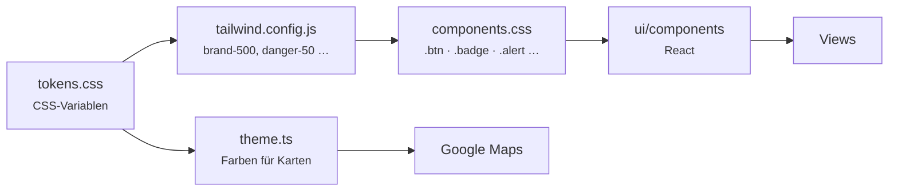

[← 4 Datenqualität](04-datenqualitaet.md) · **5 Design-System** · [6 Tests & Qualität →](06-tests-und-qualitaet.md)

# Design-System

Optik angelehnt an heizma.at: Grün `#4DA547`, Text `#20242D`, Schrift Inter. Alles, was das Aussehen bestimmt, liegt in `web/src/ui/` – Views setzen nur noch Bausteine und Layout zusammen.


## Drei Ebenen



| Ebene | Datei | Inhalt |
|---|---|---|
| **Tokens** | `ui/styles/tokens.css` | Farben (als RGB-Kanäle, damit `bg-brand-50/50` funktioniert), Radien, Schatten, Ebenen (`z-index`), Schrift |
| **Tailwind-Abbildung** | `web/tailwind.config.js` | Token-Namen als Tailwind-Farben: `brand`, `gray`, `danger`, `warning`, `info`, `accent`, `ink` |
| **Komponenten-Klassen** | `ui/styles/components.css` | Semantische Klassen im `@layer components`: `.btn--primary`, `.badge--warning-soft`, `.input--error`, `.modal-panel` … |
| **React-Komponenten** | `ui/components/*.tsx` | Typisierte Bausteine mit Varianten als Props |
| **JS-Brücke** | `ui/theme.ts` | Liest dieselben Tokens für Karten-Polylines und Marker (`routeColor(i)`, `mapColors()`) |

**Eine Farbe ändern = eine Zeile in `tokens.css`.** Tailwind-Klassen, Komponenten und Karten folgen automatisch.

## Semantische Farben statt Palette

| Token | Bedeutung in der App |
|---|---|
| `brand` | Heizma-Grün: Aktion, eingeplant, freigegeben |
| `danger` | Fehler, Regelverstoß, nicht planbar |
| `warning` | Warnung, Warteliste, bewusste Ausnahme |
| `info` | Hinweis, lokal korrigiert, fixiert |
| `accent` | Akzent (Hervorhebung) |
| `gray` | Flächen, Rahmen, Sekundärtext |
| `route-1 … route-8` | Feste Farbe je Außendienstler auf Karte und Liste |

Code liest sich dadurch nach Bedeutung: `text-danger-600` statt `text-red-600`.

## Komponenten-Katalog

Alle aus `@/ui`:

| Komponente | Props | Einsatz |
|---|---|---|
| `Button` | `variant` primary · secondary · warning · accent · ghost, `size` sm · md, `icon`, `block` | Alle Aktionen |
| `IconButton` | `icon`, `label` (wird zu `aria-label`) | Neu laden, Schließen |
| `Card` | `as` div · section · form | Weiße Fläche mit Rahmen |
| `Alert` | `tone` success · danger · warning · info · neutral, `size` | Rückmeldungen, Hinweisboxen |
| `Badge` | `tone` (10 Töne), `strong` | Status-Chips, Plan-Status |
| `Field` · `Input` · `Textarea` · `FieldMessage` | `tone` error · warning, `size`, `readOnly` | Formulare mit Validierungs-Markierung |
| `Modal` | `eyebrow`, `title`, `footer`, `padded` | Dialoge – mobil Bottom-Sheet, Escape schließt |
| `Page` · `PageHeader` · `BackLink` | `narrow`, `back`, `actions` | Einheitlicher Seitenrahmen |
| `SegmentedControl` | `options`, `value`, `onChange` (typisiert) | Filter „Alle / Nur Probleme / Eingeplant“ |
| `Loading` · `ErrorBox` · `Spinner` | `label`, `onRetry` | Ladezustände |
| `Icon` | `name` | Inline-SVG, keine Icon-Library nötig |
| `ActionList` | `items: { title, description, icon, tone, onSelect }[]` | Auswahl „Was möchtest du tun?“ im Dialog (siehe Aktionen) |

### Beispiel

```tsx
import { Alert, Button, Modal } from '@/ui';

<Modal
  onClose={close}
  eyebrow="An: Vertrieb / Planung"
  title="Intern eskalieren"
  footer={
    <>
      <Button onClick={close}>Abbrechen</Button>
      <Button variant="primary" onClick={submit}>Eskalieren</Button>
    </>
  }
>
  <Alert tone="warning" size="sm">2 ältere Anfragen warten noch.</Alert>
</Modal>
```

Vorher hatten drei Dialoge je ~10 Zeilen kopiertes Overlay-Markup; jetzt ist es eine Komponente mit Escape-Taste und Barrierefreiheit (`role="dialog"`, `aria-modal`) für alle.

## Aktionen: Karten zeigen, Dialoge ändern

Ein Muster für alle Stellen, an denen der Planer etwas tut – damit nirgends eine Reihe gleich aussehender Buttons steht:

| Regel | Umsetzung |
|---|---|
| **Karten zeigen nur den Status** | Badge + ein Satz „wann/bei wem“ oder „warum nicht“. Keine Aktions-Reihen. |
| **Ein Einstieg je Karte** | `Planung ändern …` (bzw. ein klarer nächster Schritt wie `Koordinaten finden`). Höchstens ein Primär- und ein Sekundär-Button, `size="sm"`, links. |
| **Änderungen laufen im Dialog** | `Modal` + `ActionList`: nur die Schritte, die im aktuellen Status möglich sind, je mit einem Satz, was danach passiert. |
| **Jeder Schritt mit Vorschau oder Begründung** | Verschieben zeigt Uhrzeit und Zusatz-Fahrzeit; Herausnehmen und Regelbruch verlangen einen Grund. Fußzeile immer `Zurück` · Bestätigen. |
| **„…“ heißt: es folgt ein Dialog** | `Planung ändern …`, `Verfügbarkeit anfragen …` – ohne Punkte passiert die Aktion sofort. |
| **Ein großer Button pro Seite** | Nur der Seitenabschluss (z. B. „Routen freigeben“) ist `md` und vollbreit. |

`Modal` hängt per Portal an `<body>` – ein Dialog kann einen weiteren öffnen (Stopp-Dialog → „Planung ändern“), `Escape` schließt nur den obersten.

## Styling-Regeln

1. **Views verwenden Bausteine aus `@/ui`** und Tailwind nur für Layout (`flex`, `gap`, `grid`, Abstände) und Token-Farben.
2. **Keine Hex-Farben, keine Palette-Farben** (`red-`, `amber-` …) außerhalb von `ui/`.
3. **Keine selbstgebauten Buttons, Dialoge oder Hinweisboxen.**
4. **Ebenen über Tokens:** `z-modal`, `z-header`, `z-sidebar` statt `z-[2000]`.

Regeln 2 und 3 prüft `npm run check:architecture` automatisch ([Tests & Qualität](06-tests-und-qualitaet.md)).

## Ohne sichtbare Änderung umgestellt

Die Tokens enthalten 1:1 die bisherigen Werte. Ein Pixel-Vergleich alter gegen neuer Build (Playwright, 1440 px) ergab:

| Seite | Abweichende Pixel |
|---|---|
| Anfragen, Außendienst, Handlungsbedarf, Hilfe | 0 |
| Stammdaten-Übersicht | 15 (Kantenglättung) |
| Planer, Planer mit Route | < 0,03 % |
| Bearbeiten | Deaktivierte Sekundär-Buttons sehen jetzt deaktiviert aus (vorher nicht) |

---

[← 4 Datenqualität](04-datenqualitaet.md) · [6 Tests & Qualität →](06-tests-und-qualitaet.md)
